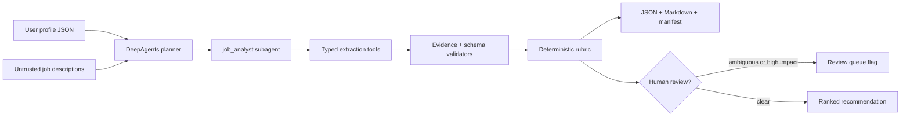

# Job Fit Research Agent

[](https://github.com/zt5rice/job-fit-research-agent/actions/workflows/ci.yml)

An independent, evidence-backed job-fit research prototype. It compares a
candidate profile with user-provided job descriptions and returns
`apply / investigate / skip` recommendations with explicit gaps, source
quotes, deterministic scores, and human-review flags.

> Independent prototype. Not affiliated with LinkedIn or any job board.
> It does not use authenticated scraping, cookies, anti-bot bypasses, or
> automated applications. It is not production software.

## The problem

Job seekers need to answer two different questions:

1. What does this posting actually require?
2. Which requirements are genuinely supported by my profile?

Generic LLM summaries blur those questions and often produce an opaque score.
This project separates extraction from judgment: a DeepAgents planner can
delegate job analysis, while deterministic Python validates evidence and
calculates the only score that reaches the report.

## Architecture



### What DeepAgents does

- Plans the analysis and can delegate one posting to the `job_analyst`
  subagent through DeepAgents' `task` tool.
- Selects from controlled read, extraction, and validation tools.
- Uses a filesystem-backed context for local input inspection.
- Synthesizes a structured `JobPosting` candidate that deterministic code
  validates before use.

The live assembly calls the real
`deepagents.create_deep_agent(...)` API in
`src/job_fit/agent.py`. A test also constructs a real DeepAgents graph with an
injected fake chat model, so CI does not need model credentials.

### What is deterministic

- JSON contract and schema validation.
- Evidence quote and line-location checks.
- Evidence-coverage calculation.
- Must-have and nice-to-have extraction from local Markdown fixtures.
- Hard-blocker detection for sponsorship, citizenship, and clearance terms.
- The fixed 30/30/15/15/10 rubric and recommendation bands.
- Human-review routing and report/manifest generation.

The model cannot supply the final score. `score_job()` does not accept a model
score; it computes the result from validated profile and posting facts only.

## Quickstart

```bash
python3.11 -m venv .venv && source .venv/bin/activate && pip install -e .
python -m job_fit demo --offline
python -m job_fit eval --output reports/eval_report.json
open reports/demo/ranked_jobs.md
```

The offline demo uses only synthetic fixtures and writes:

```text
reports/demo/
├── assessment_job_001_strong.json
├── assessment_job_002_investigate.json
├── assessment_job_003_blocked.json
├── ranked_jobs.json
├── ranked_jobs.md
└── run_manifest.json
```

## Evidence and human review

Every extracted requirement carries an exact quote and one-based line span.
Validation rejects quotes that do not appear in the source, duplicate evidence
IDs, out-of-range locators, missing evidence, and malformed model output.

A result is routed to human review when:

- evidence coverage is below 80%;
- work authorization is unclear;
- a hard blocker conflicts with the profile;
- job text contains suspicious embedded instructions; or
- live model output fails validation and the controlled deterministic fallback
  is used.

Hard blockers cap the score below the `apply` band. A missing must-have set can
also cap the total. Each cap is stated in the score explanation and represented
in the published breakdown.

## Live mode

Live mode uses an OpenAI-compatible endpoint:

```bash
export OPENAI_API_KEY="..."
export OPENAI_BASE_URL="https://api.openai.com/v1"  # optional
export MODEL_NAME="gpt-4.1-mini"
python -m job_fit demo --live
```

`OPENAI_BASE_URL` supports compatible gateways. Never commit `.env`, API keys,
cookies, or private profiles. Offline tests do not read any model credentials.

## Evaluation

`evals/labeled_jobs.json` contains 15 hand-written synthetic cases: six
strong-fit, three borderline, three weak-fit, and three hard-blocker cases.
The runner reports recommendation accuracy, evidence coverage, unsupported
claims, review routing, and hard-blocker false-positive apply rate. CI treats a
hard-blocker `apply`, low evidence coverage, or unsupported claim as a
regression.

See [the five-minute demo script](docs/DEMO.md) and the sanitized
[example outputs](examples/sample_outputs/ranked_jobs.md).

## Local-only data boundary

Input job data and candidate profiles are local-only. The public repository
contains only synthetic fixtures and sanitized example outputs.

The `.gitignore` excludes `data/*`, `.env`, virtual environments, caches,
`reports/`, and `artifacts/`. The local CSV used during development is never
copied into fixtures, commits, CI artifacts, or releases.

## Controlled-agent architecture mapping

| Control-plane concern | Implementation |
|---|---|
| Planning | DeepAgents planner in live mode; deterministic pipeline in offline mode |
| Typed tool contracts | `contracts.py` and typed tool functions |
| Execution state | Per-job records plus `run_manifest.json` |
| Deterministic verification | `validation.py` |
| Evidence and audit | Evidence IDs, quotes, line spans, input hashes |
| Human approval | Review reasons and no automated external action |
| Evaluation | Labeled synthetic corpus and regression gate |
| Controlled improvement | Retrieval/rubric/prompt versions in the manifest |

## Limitations

- This is a controlled architecture prototype, not production software.
- Offline extraction is intentionally rule-based and works best with the
  documented Markdown fixture format.
- Live model quality depends on the configured provider and is not guaranteed.
- The current prototype supports local job descriptions only; it does not
  fetch public career pages.
- The rubric is transparent but not empirically calibrated against a large
  hiring dataset.
- No output should be used externally without human review.

## License

MIT. See [LICENSE](LICENSE).

